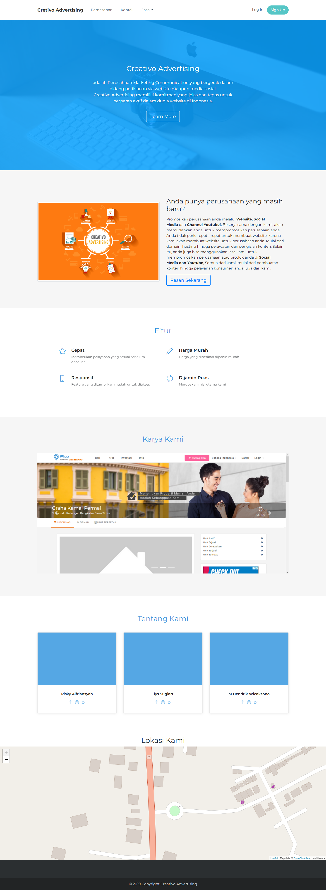
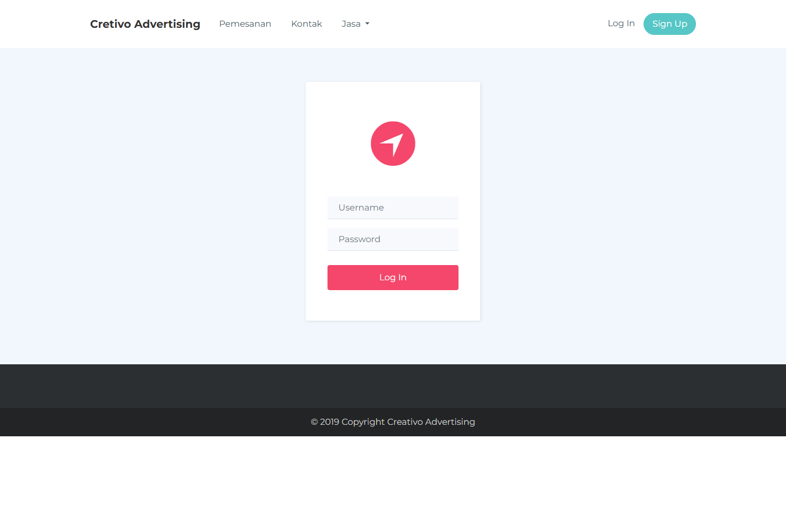
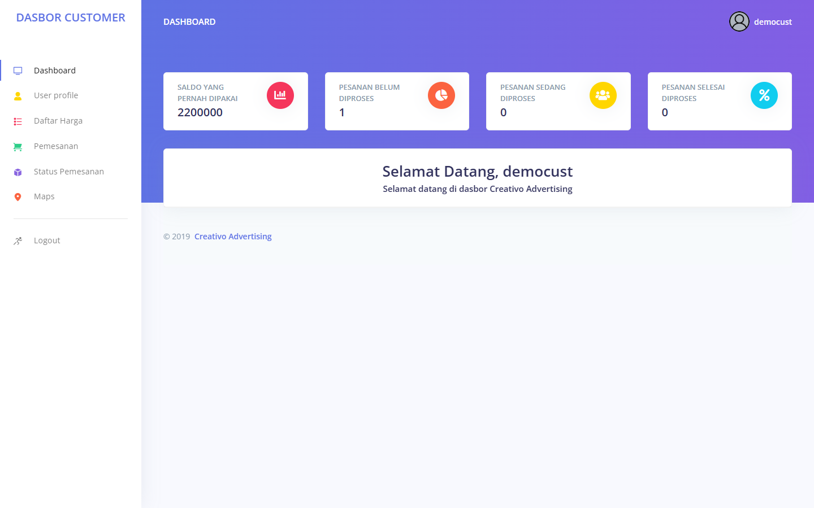
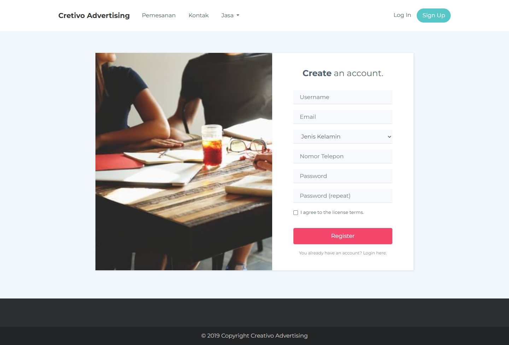
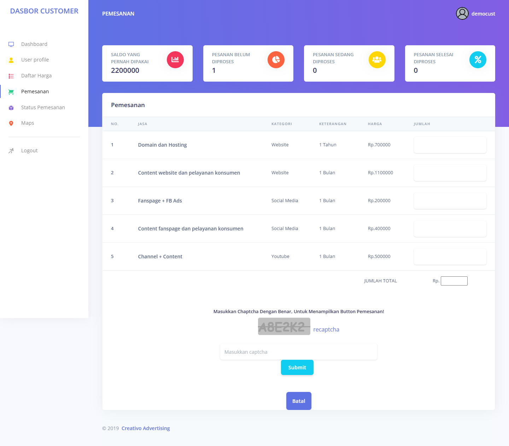
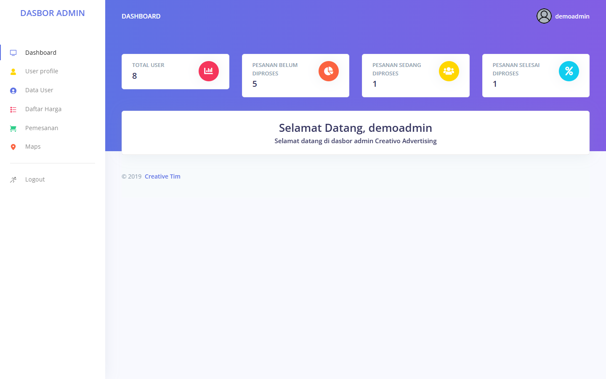
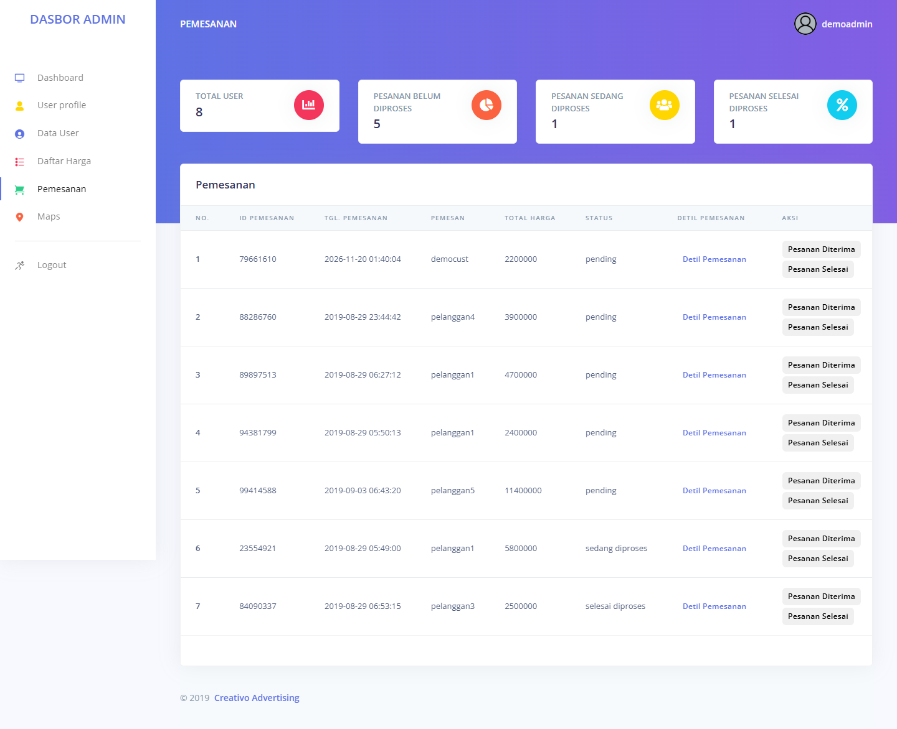
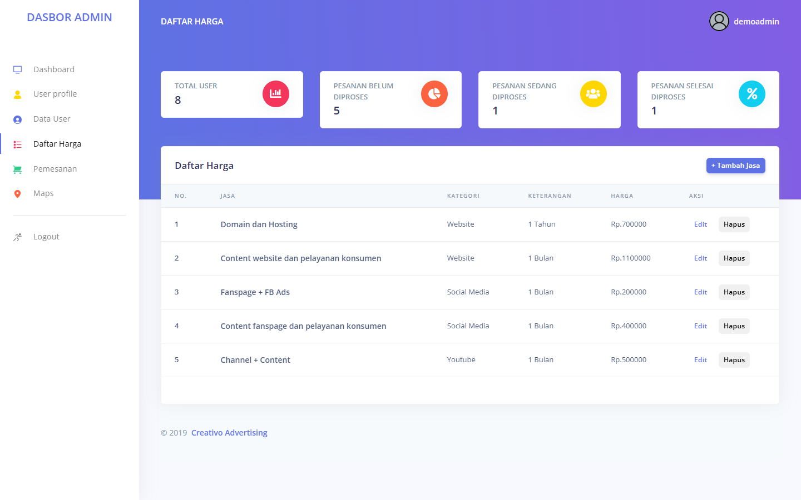
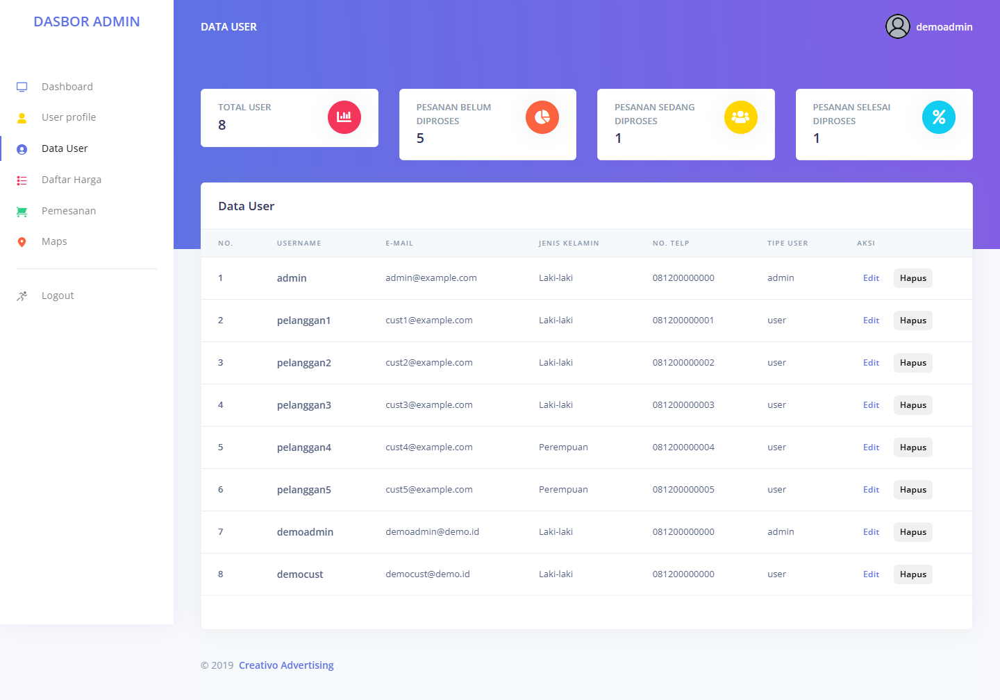
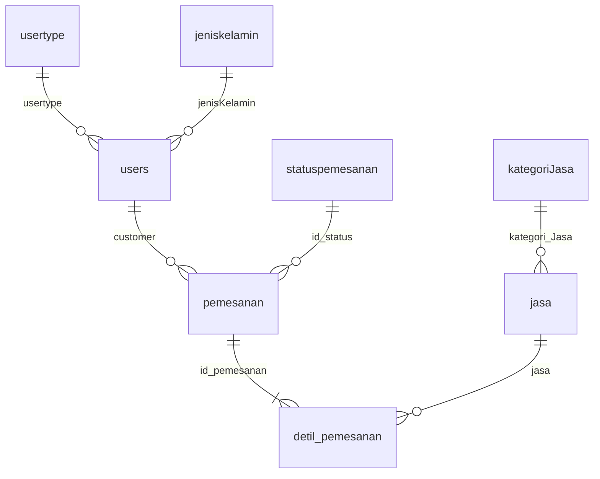

# Creativo Advertising

**Web penjualan jasa marketing digital**: pembuatan website, pengelolaan social media, dan channel YouTube. Customer bisa melihat daftar harga, memesan jasa, dan memantau status pesanan. Admin mengelola jasa, user, dan memproses pesanan.

Proyek tugas kuliah (2019), ditulis dengan **PHP native + MySQL**, tanpa framework. Sekarang sudah dibungkus Docker supaya bisa dijalankan di mesin mana pun dengan satu perintah.



---

## Fitur

**Pengunjung**
- Landing page profil perusahaan, portofolio, tim, dan peta lokasi
- Halaman detail jasa: Website, Social Media, YouTube
- Registrasi dan login (password di-hash dengan `password_hash`)

**Customer** (`/customer`)
- Dashboard ringkasan: total pengeluaran, jumlah pesanan pending / diproses / selesai
- Daftar harga jasa
- Form pemesanan dengan hitung total otomatis dan captcha, lalu instruksi pembayaran
- Status pemesanan beserta detail item
- Edit profil

**Admin** (`/admin`)
- Dashboard: total user dan statistik pesanan
- Kelola pesanan: lihat detail, ubah status *pending → sedang diproses → selesai*
- Kelola jasa: tambah, ubah, hapus
- Kelola user: lihat, ubah, hapus

## Screenshot

| Landing & login | Customer |
|---|---|
|  |  |
|  |  |

| Admin | |
|---|---|
|  |  |
|  |  |

<details>
<summary>Semua screenshot</summary>

| File | Halaman |
|---|---|
| `01-landing` | Landing page |
| `02-jasa-website`, `03-jasa-sosmed`, `04-jasa-youtube` | Halaman detail jasa |
| `05-login`, `06-daftar` | Login & registrasi |
| `10`–`15-customer-*` | Dashboard, daftar harga, pemesanan, status, profil, maps |
| `20`–`26-admin-*` | Dashboard, pesanan, daftar jasa, tambah jasa, data user, profil, maps |

Semua ada di folder [`screenshots/`](screenshots/).
</details>

## Tech stack

| Lapisan | Teknologi |
|---|---|
| Backend | PHP (native, `mysqli`), sudah dites di PHP 8.2 |
| Database | MySQL 8 (aslinya MariaDB 10.3) |
| Frontend | Bootstrap 4, jQuery, Leaflet + OpenStreetMap |
| Template dashboard | [Argon Dashboard](https://www.creative-tim.com/product/argon-dashboard) (Creative Tim, MIT) untuk `/admin` dan `/customer` |
| Deploy | Docker + Docker Compose (Apache + PHP, MySQL) |

## Struktur folder

```
.
├── index.php, website.php, sosmed.php, youtube.php   # halaman publik
├── login.php, daftar.php, logout.php                 # autentikasi
├── functions.php                                     # koneksi DB + fungsi CRUD
├── customer/                                         # dashboard customer
├── admin/                                            # dashboard admin
├── assets/                                           # CSS, JS, gambar halaman publik
├── id9352934_creativo.sql                            # skema + data awal database
├── Dockerfile, docker-compose.yml, .env.example      # deployment
├── docker/seed-demo.sql                              # akun demo (opsional, lokal saja)
├── screenshots/                                      # screenshot untuk README
├── README.md
└── DEPLOY.md                                         # panduan deploy lengkap (lokal + VPS)
```

## Skema database



Role: `usertype 1` = admin, `usertype 2` = customer. Status pesanan: `1` pending, `2` sedang diproses, `3` selesai diproses.

## Menjalankan (cara cepat)

Butuh [Docker](https://www.docker.com/products/docker-desktop/) (di Windows/Mac pastikan Docker Desktop sudah dibuka).

```bash
docker compose up -d --build --wait
```

Buka **http://localhost:8080**. Database ter-import otomatis dari `id9352934_creativo.sql` saat pertama kali jalan.

Untuk login, buat akun demo (sekali saja). Username dan password-nya ada di header file [`docker/seed-demo.sql`](docker/seed-demo.sql):

```bash
docker compose exec -T db sh -c 'mysql -u"$MYSQL_USER" -p"$MYSQL_PASSWORD" "$MYSQL_DATABASE"' < docker/seed-demo.sql
```

> Akun contoh bawaan dump (`admin`, `pelanggan1` sampai `pelanggan5`) berisi data fiktif dengan password acak, jadi tidak bisa dipakai login. Pakai akun demo di atas, atau daftar akun customer baru lewat `/daftar.php`.

Matikan: `docker compose down` (data tetap ada). Reset total termasuk database: `docker compose down -v`.

Panduan lengkap, termasuk **deploy ke VPS dengan HTTPS**, backup, dan troubleshooting: lihat **[DEPLOY.md](DEPLOY.md)**.

## Catatan

- Proyek ini dibuat untuk belajar. Kode sudah diperkuat dan diuji (82 tes otomatis): halaman `/admin/*` dilindungi guard login + role admin (`admin/auth.php`), semua query memakai *prepared statement* (SQL injection), semua form memakai token CSRF dan aksi destruktif hanya lewat POST, semua output di-escape (XSS), serta celah eskalasi role, IDOR pesanan, dan manipulasi harga sudah diperbaiki. Yang **belum ada**: pembatasan percobaan login (brute force) dan Content-Security-Policy. Detail ada di bagian keamanan [DEPLOY.md](DEPLOY.md#9-catatan-keamanan).

Aturan untuk kode baru: query pakai `dbq()` / `query()` dengan `?`, output pakai `<?= e($x) ?>`, dan setiap `<form method="post">` wajib memuat `<?= csrf_field() ?>`.
- Info rekening dan e-mail di halaman pemesanan hanyalah contoh dari tugas kuliah.
